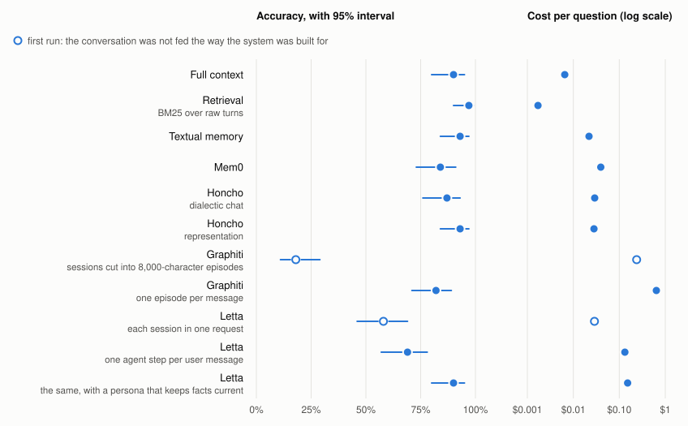
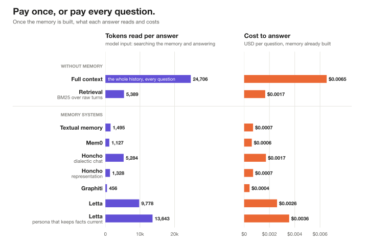

# agent-memory-eval

How LLM agent memory systems actually work, traced call by call, and what that
costs them on a real benchmark.

Most comparisons of agent memory systems are either feature tables or vendor
benchmark results. This repository takes a third route. It runs the same short
conversation, in which a user changes their mind, through each system with every
model call shown, so you can see what was extracted, what was overwritten, what
was retrieved, and how many calls it took. It then checks the same behaviour at
a larger scale on the knowledge-update questions of
[LongMemEval](https://arxiv.org/abs/2410.10813).

<picture>
  <source media="(prefers-color-scheme: dark)" srcset="docs/figures/architecture/overview-dark.svg">
  
</picture>

## Systems covered

What sets the systems apart is one question: who decides what gets written to
memory? The notebooks are numbered in reading order, from the simplest system
to the most elaborate.

| | System | Who writes | What is run |
|--:|---|---|---|
| 0 | [No memory, and full context](https://anton-dergunov.github.io/agent-memory-eval/notebooks/00-introduction.html) | Nobody | our code: the conversation, and the two baselines |
| 1 | [Textual memory](https://anton-dergunov.github.io/agent-memory-eval/notebooks/01-textual.html) | A background rewriter of one text file | our code, about 50 lines; the same prompt as the experiment |
| 2 | [Mem0](https://anton-dergunov.github.io/agent-memory-eval/notebooks/02-mem0.html) | An extraction pipeline | the real library |
| 3 | [Zep / Graphiti](https://anton-dergunov.github.io/agent-memory-eval/notebooks/03-zep-graphiti.html) | A pipeline, into a dated graph | Graphiti's prompts, driven by local code |
| 4 | [Letta (MemGPT)](https://anton-dergunov.github.io/agent-memory-eval/notebooks/04-letta.html) | The agent itself | Letta's prompts and tool descriptions, driven by local code |
| 5 | [Honcho](https://anton-dergunov.github.io/agent-memory-eval/notebooks/05-honcho.html) | A background reasoner | our prompts, written from Honcho's published definitions |
| | Plain retrieval over raw turns | Nobody | our code, in the experiment only |

Three of the five system notebooks are re-implementations made so that every
step can be read. Each notebook says at the top what it takes from the
original system and what it leaves out. The experiment runs the real systems:
Mem0 2.2.1, Graphiti 0.31.1 on Neo4j, Letta 0.16.8 and Honcho v3.3.0, all on
the same model.

The notebooks are in [notebooks/](notebooks/). The system names above link to
their rendered pages, which read better on a tablet or phone than GitHub's
notebook view.

## What each notebook shows

Every notebook starts with one screen that explains the idea, with a diagram,
and then uses the same hand-written conversation, introduced in notebook 0: two
sessions four months apart and a question in a third. The user states a diet in
the first session, reverses it in the second, and introduces two other people
with constraints of their own. The closing question can only be answered
correctly from the updated facts. Each system notebook then follows four
stages:

1. **Writing.** What the system keeps from a conversation and what it drops.
2. **Revising.** What happens to the old fact when a new one contradicts it.
3. **Reading.** What a new session gets back, and whether the answer changes.
4. **Cost.** Model calls and tokens for the same two sessions.

The five runs side by side:

<picture>
  <source media="(prefers-color-scheme: dark)" srcset="docs/figures/architecture/series-dark.svg">
  
</picture>

## Results on LongMemEval

67 knowledge-update questions, history trimmed to 10 sessions (about 28,000
tokens), `gemini-3.1-flash-lite` for every model call the systems and the
answerer make, `gemini-3.1-pro-preview` as judge. Not comparable to published
LongMemEval results: each history is cut from about 48 sessions to 10, only
one of the benchmark's question types is used (67 of its 500 questions), and
the answering and judging models differ from the paper's.

<picture>
  <source media="(prefers-color-scheme: dark)" srcset="docs/figures/results-dark.svg">
  
</picture>

| Arm | Accuracy | 95% interval | Cost to build and answer | Model calls to write |
|---|--:|---|--:|--:|
| Full context | 90% | 80%–95% | $0.007 | 0 |
| Retrieval (BM25 over raw turns) | 97% | 90%–99% | $0.002 | 0 |
| Textual memory | 93% | 84%–97% | $0.022 | 10 |
| Mem0 | 84% | 73%–91% | $0.039 | 10 |
| Graphiti | 82% | 71%–89% | $0.640 | 720 |
| Letta | 69% | 57%–78% | $0.132 | 81 |
| Letta, persona that keeps facts current | 90% | 80%–95% | $0.152 | 88 |
| Honcho, dialectic chat | 87% | 76%–93% | $0.029 | 38 |
| Honcho, representation | 93% | 84%–97% | $0.028 | 38 |

On a history this short most memory systems lose little against reading the
whole thing, and what separates them is cost: Graphiti spends 30 times what
textual memory spends. At its defaults Letta trails, because its agent often
notices a revision without writing it down and its search rarely finds the
message again. Three lines in its persona block, asking it to date facts,
update them and search with short words, bring it to 90%.

Why keep a memory at all, then? Because a memory system and full context pay
at different times. A memory system pays once, to build its memory, and then
each answer reads far less than the whole history. Full context pays for the whole history on every
question, and a history only grows.

<picture>
  <source media="(prefers-color-scheme: dark)" srcset="docs/figures/answering-dark.svg">
  
</picture>

The analysis, the failure breakdown and the
full-history run are in [docs/experiment-results.md](docs/experiment-results.md),
with the tables in [docs/findings/](docs/findings/); how to run it is in
[docs/experiment.md](docs/experiment.md).

## Running the notebooks

```bash
uv sync --python 3.12
uv run python -m ipykernel install --user --name agent-memory-eval --display-name agent-memory-eval
```

`uv sync` creates `.venv` with the versions pinned in `uv.lock`; add
`--extra experiment` if the same environment should also run the experiment,
since a plain `uv sync` removes the experiment's packages.

Put `GEMINI_API_KEY` in a `.env` file at the top of the repository, open a
notebook in VS Code or JupyterLab, and pick the **agent-memory-eval** kernel.
The Zep/Graphiti notebook draws its graphs with Graphviz, which has to be
installed separately (`brew install graphviz`).

The models are set in one place, [notebooks/config.py](notebooks/config.py):
`gemini-3.1-flash-lite` for chat and `gemini-embedding-001` for embeddings. The
free tier of the Gemini API is enough. It allows 15 chat requests a minute, and
the notebooks wait between calls to stay under that, so the longest one takes
about five minutes.

## How the notebooks are stored

The `.ipynb` is the version in git, with its outputs, because the outputs are
the point: the prose, the code and the results together are what make a notebook
worth reading, and they can be read without an API key.

Each notebook is also paired by [jupytext](https://jupytext.readthedocs.io/)
with a script, `<name>.nb.py`: the same content as plain Python, which is far
easier to diff, to search, and to hand to a coding assistant. That file is
generated and gitignored. The pairing is declared in `jupytext.toml`, so any
clone can recreate it:

```bash
jupytext --sync notebooks/02-mem0.ipynb
```

VS Code users get both directions as tasks (`.vscode/tasks.json`), each guarded
so that a sync fails loudly instead of overwriting the side that has newer work
in it.

When a script is synced back into a notebook, jupytext keeps the outputs already
there, including on cells whose code changed. Re-run those cells before
committing, or the notebook will show results its code did not produce.

## Reading on a tablet

[lectern](https://github.com/anton-dergunov/lectern) serves the notebooks as
pages laid out for a tablet:

```bash
lectern serve
```

run at the top of the repository, then open the address it prints (for example
`http://<your-mac>.local:8642/`) on the tablet.

## Layout

| Path | Contents |
|---|---|
| [notebooks/](notebooks/) | Notebook 0 (the conversation and the two baselines), then one numbered notebook per system; `config.py` for the models, `letta_source.py` for fetching Letta's prompts |
| [src/memeval/](src/memeval/) | The LongMemEval experiment: data, model calls, one module per arm, judge, report |
| [infra/](infra/) | Scripts that start the Neo4j (Graphiti), Letta and Honcho servers |
| [results/](results/) | Every result of the pilot, main and full-history runs, with the call ledgers |
| [docs/](docs/) | [experiment.md](docs/experiment.md) (how it runs), [experiment-results.md](docs/experiment-results.md) (what it found) |
